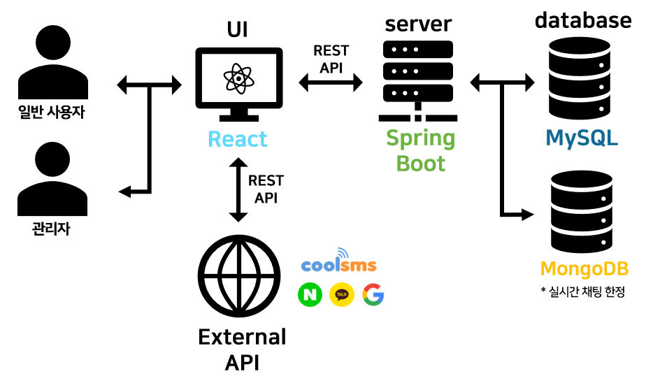
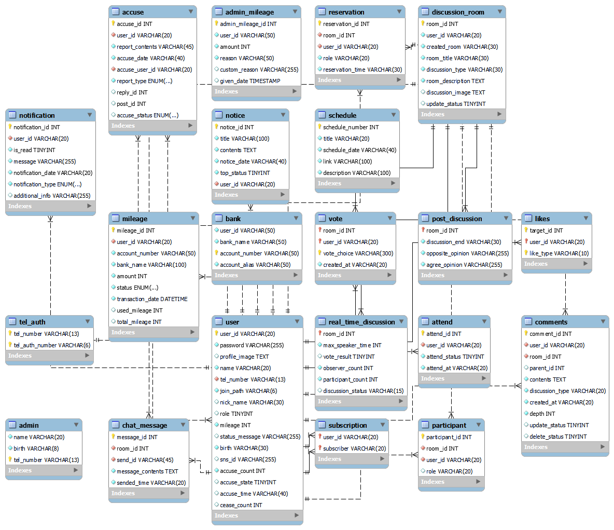

# DoranDoran
해당 문서는 커뮤니티 기반 웹 서비스 'DoranDoran'의 백엔드 서비스를 설명하고 있습니다.

## 목차
1. [프로젝트 소개](#프로젝트-소개)
2. [개발 스택](#개발-스택)
3. [폴더 구조](#폴더-구조)
4. [설치 및 실행](#설치-및-실행)
5. [기타 설정](#기타-설정)
6. [주요 기능](#주요-기능)
7. [시스템 아키텍처](#시스템-아키텍처)
8. [ERD](#ERD)
9. [제작 기간](#제작-기간)
10. [라이선스](#라이선스)

---

## 프로젝트 소개
사용자들이 시사/교양, 과학, 경제 혹은 기타 궁금한 주제에 관해 토론 게시글을 생성하여 자유롭게 의견을 주고 받을 수 있도록 제작한 커뮤니티 기반 웹 서비스입니다. 생성한 토론 게시글 내에서는 투표를 통해 찬반 결과 또한 얻을 수 있습니다. 또한 관리자가 주기적으로 생성하는 실시간 채팅 토론방에 참여 가능합니다. 추가적으로 댓글 혹은 게시글 신고 기능과 사용자 구독 기능도 제공하고 있습니다.

 이에 출석체크, 마일리지 지급(토론 참여 시, 출석체크 시, 매해 생일 마다, 혹은 기타 사유로 관리자 재량으로 제공) 및 환급 제도를 추가하였고, 마일리지나 토론 참여에 관한 모든 이벤트 발생에 대해 알림을 보내주어 접근성을 높였습니다.

 JWT(Json Web Token), AuthenticationPrincipal(annotation) 활용하여 보안에 더욱 신경썼으며, 일반 계정과 관리자 계정을 따로 두어 완성도를 향상시켰습니다.

---

## 개발 스택
백엔드에서 사용한 주요 기술들을 나열합니다.
- **프로그래밍 언어**: Java  
- **프레임워크**: Spring Boot 
- **데이터베이스**: MySQL, MongoDB(실시간 토론 한정)
- **API 통신**: REST API 
- **서버**: Tomcat
- **버전 관리**: Git

---

## 폴더 구조
프로젝트의 주요 폴더 구조를 설명합니다.

```plaintext
THEMEMORIALDAY/
 ┣ .gradle/                             # Gradle 관련 캐시 및 설정 파일
 ┣ .vscode/                             # Visual Studio Code 관련 설정 파일
 ┣ 시스템 아키텍처/                     # 시스템 아키텍처 문서 또는 다이어그램
 ┣ build/                               # Gradle 빌드 결과물이 저장되는 폴더
 ┣ gradle/                              # Gradle 관련 설정 파일 및 스크립트
 ┣ src/                                 # 소스 코드 디렉토리
 ┃ ┣ main/                              # 메인 소스 코드
 ┃ ┃ ┣ java/com/korit/dorandoran        # 자바 소스 코드 경로
 ┃ ┃ ┃ ┣ common/                        # 공통 모듈 또는 유틸리티 클래스
 ┃ ┃ ┃ ┣ config/                        # 애플리케이션 설정 관련 클래스
 ┃ ┃ ┃ ┣ controller/                    # API 요청을 처리하는 컨트롤러
 ┃ ┃ ┃ ┣ dto/                           # 데이터 전송 객체(Data Transfer Object)
 ┃ ┃ ┃ ┣ entity/                        # 데이터베이스 엔티티 클래스
 ┃ ┃ ┃ ┣ filter/                        # 필터 클래스 (예: 인증, 로깅)
 ┃ ┃ ┃ ┣ handler/                       # 예외 처리기 또는 요청 핸들러
 ┃ ┃ ┃ ┣ provider/                      # 외부 서비스 제공자와의 인터페이스
 ┃ ┃ ┃ ┣ repository/                    # 데이터베이스 접근 레이어
 ┃ ┃ ┃ ┣ service/                       # 비즈니스 로직 처리 클래스
 ┃ ┃ ┃ ┣ DoranDoranApplication.java     # 메인 애플리케이션 클래스
 ┃ ┃ ┣ resources/                       # 리소스 파일 (예: 설정 파일, 정적 파일)
 ┃ ┃ ┃ ┣ application.properties         # 애플리케이션 설정 파일
 ┃ ┃ ┃ ┣ .env                           # 애플리케이션 환경 설정 파일
 ┣ .gitattributes                        # Git 속성 설정 파일
 ┣ .gitignore                            # Git에서 무시할 파일 목록
 ┣ build.gradle                          # Gradle 빌드 설정 파일
 ┣ gradlew                               # Gradle Wrapper 스크립트 (Unix 계열)
 ┣ gradlew.bat                           # Gradle Wrapper 스크립트 (Windows)
 ┗ README.md                             # 프로젝트 소개 파일
 ┗ settings.gradle                       # Gradle 설정 파일

```

---

## 설치 및 실행 

### 필수 조건
- **Java**: 3.3.3 이상 (jar 17 이상)
- **Gradle**: 3.8.1 이상
- **MySQL**: 8.0.31 이상 (데이터베이스 설정 필요)
- **MongoDB**: 8.0.6 이상 (데이터베이스 설정 필요)

### 설치 단계
1. 저장소 클론
   ```bash
   git clone https://github.com/DoranDoran-team/back.git
2. 디렉토리로 이동
   ```bash
   cd 저장소이름
3. 데이터베이스 설정
- MySQL 서버를 실행하고 데이터베이스를 생성합니다.
- src/main/resources/application.properties 파일에서 다음을 설정합니다.
    ```bash
    spring.datasource.driver-class-name=com.mysql.cj.jdbc.Driver
    spring.datasource.url=jdbc:mysql://127.0.0.1:3306/데이터베이스이름?serverTimezone=UTC&characterEncoding=UTF-8
    spring.datasource.username=사용자이름
    spring.datasource.password=비밀번호
3. 의존성 추가
    ```bash
    runtimeOnly 'io.jsonwebtoken:jjwt-impl:0.11.2'
    implementation 'io.jsonwebtoken:jjwt-api:0.11.2'
    runtimeOnly 'io.jsonwebtoken:jjwt-jackson::0.11.2'
4. 개발 서버 실행
   ```bash
   gradle bootRun
- 서버가 성공적으로 시작되면 http://localhost:4000에서 확인할 수 있습니다.

---
## 기타 설정
src/main/resources/application.properties 파일에서 다음을 설정합니다.

1. JWT 비밀키
   ```bash
   jwt.secret=JWT 토큰의 서명을 위한 비밀키
2. Request 사이즈 제한 조정 
   ```bash
   spring.servlet.multipart.max-file-size=업로드 가능한 최대 파일 크기 # 예시: 100MB
   spring.servlet.multipart.max-request-size=요청의 최대 크기 # 150MB 
3. file 작업 경로 
   ```bash
   file.path= 파일 경로
   file.url=파일 접근 URL
4. COOL SMS API KEY, SECRET KEY
   ```bash
   cool-sms.api-key=COOL SMS API 키
   cool-sms.secret-key=COOL SMS 비밀 키
   cool-sms.domain=COOL SMS 도메인
   cool-sms.from=발신자 전화번호
5. Kakao OAuth 클라이언트 설정 
   ```bash
   spring.security.oauth2.client.registration.kakao.client-id=Kakao 클라이언트 ID
   spring.security.oauth2.client.registration.kakao.client-secret=Kakao 클라이언트 비밀 키
   spring.security.oauth2.client.registration.kakao.redirect-uri={baseUrl}/oauth2/callback/{registrationId} # 리다이렉트 URI
   spring.security.oauth2.client.registration.kakao.authorization-grant-type=authorization_code # 인증 방식
   spring.security.oauth2.client.registration.kakao.client-authentication-method=client_secret_post # 클라이언트 인증 방법
   spring.security.oauth2.client.registration.kakao.scope=profile_nickname # 요청할 사용자 정보 범위
6. Kakao OAuth2 제공자 설정 
   ```bash
   spring.security.oauth2.client.provider.kakao.authorization-uri=Kakao 인증 URI
   spring.security.oauth2.client.provider.kakao.token-uri=Kakao 토큰 URI
   spring.security.oauth2.client.provider.kakao.user-info-uri=Kakao 사용자 정보 URI
   spring.security.oauth2.client.provider.kakao.user-name-attribute=id # 사용자 이름 속성
7. Naver OAuth 클라이언트 설정  
   ```bash
   spring.security.oauth2.client.registration.naver.client-id=Naver 클라이언트 ID
   spring.security.oauth2.client.registration.naver.client-secret=aver 클라이언트 비밀 키
   spring.security.oauth2.client.registration.naver.redirect-uri={baseUrl}/oauth2/callback/{registrationId} # 리다이렉트 URI
   spring.security.oauth2.client.registration.naver.authorization-grant-type=authorization_code # 인증 방식
   spring.security.oauth2.client.registration.naver.scope=email # 요청할 사용자 정보 범위
8. Naver OAuth2 제공자 설정 
   ```bash
   spring.security.oauth2.client.provider.naver.authorization-uri=Naver 인증 URI
   spring.security.oauth2.client.provider.naver.token-uri=Naver 토큰 URI
   spring.security.oauth2.client.provider.naver.user-info-uri=Naver 사용자 정보 URI
   spring.security.oauth2.client.provider.naver.user-name-attribute=response # 사용자 이름 속성
9. Google OAuth 설정 
   ```bash
   spring.security.oauth2.client.registration.google.client-id=Naver 인증 URI
   spring.security.oauth2.client.registration.google.client-secret=Naver 토큰 URI
   spring.security.oauth2.client.registration.google.redirect-uri={baseUrl}/oauth2/callback/{registrationId} # Naver 사용자 정보 URI
   spring.security.oauth2.client.registration.google.authorization-grant-type=authorization_code # 인증 방식
   spring.security.oauth2.client.registration.google.scope=profile,email  # 요청할 사용자 정보 범위
10. Google OAuth2 프로바이더 설정 
    ```bash
    spring.security.oauth2.client.provider.google.authorization-uri=Google 인증 URI 
    spring.security.oauth2.client.provider.google.token-uri=Google 토큰 URI 
11. 서버 포트 설정
    ```bash
    spring.application.name=thememorialday
    server.port=4000 
12. 유저 상태 자동 업데이트
    ```bash
    spring.main.allow-bean-definition-overriding=true
    ```
13. MongoDB 데이터베이스 연결
    ```bash
    spring.data.mongodb.uri=mongodb://localhost:27017/dorandoran_chat
    ```
---

## 주요 기능
DoranDoran이 제공하는 주요 기능입니다.  

 1. 로그인, 아이디 찾기, 비밀번호 찾기, 회원가입
 2. 일반 회원 및 관리자 계정을 분리하여 서비스 제공
 3. 일반 토론 게시글 작성 및 찬반 투표, 댓글 기능
 4. 관리자가 생성한 실시간 토론방을 통해 실시간 유저간 토론 및 투표 기능
 5. 관리자가 생성한 일정을 통해 유저는 실시간 토론 일정 확인
 6. 일반 회원간 팔로우 및 팔로우 취소 기능
 7. 일반 회원간 신고 기능 및 관리자 권한으로 신고 처리
 8. 활동에 따른 마일리지 지급과 마일리지 환급에 대한 기능
  
### 마이페이지
#### 일반 회원
 1. 비밀번호 확인 후 개인 정보 수정 및 탈퇴
 2. 출석 체크 기능
 3. 서비스 활동에 따른 마일리지 관리
 4. 마일리지 환급을 위한 계좌 관리
 5. 일반 회원간 팔로우 기능
 6. 개인 프로필 수정 기능
 7. 로그인한 유저가 개설한 토론방을 상태별로 확인 가능

#### 관리자
 1. 일반 유저로부터 들어온 신고 내역 처리
 2. 일반 유저의 마일리지 관리
 3. 신고 누적으로 인한 활동 중지 처리

#### 메인화면

---

## 시스템 아키텍처
본 프로젝트의 총 시스템 아키텍처입니다. 



---

## ERD
본 프로젝트의 Entity Relationship Diagram입니다.   
1. mySQL



2. mongoDB


<br/>

### 테이블 설명

1. `tel_auth`
- **설명**: 유저의 전화번호 인증 정보를 관리하는 테이블입니다.
- **주요 필드**:
  - `tel_number`: VARCHAR(13) NOT NULL, 유저 전화번호 (Primary Key)
  - `tel_auth_number`: VARCHAR(6) NOT NULL, 유저 전화번호 인증번호(Primary Key)

2. `user`
- **설명**: 유저 정보를 저장하는 테이블로, 인증 및 권한 관리를 포함합니다.
- **주요 필드**:
  - `user_id`: VARCHAR(20) NOT NULL, 유저 아이디 (Primary Key)
  - `password`: VARCHAR(255) NOT NULL, 유저 비밀번호
  - `profile_image`: TEXT NOT NULL, 유저 프로필 이미지 링크
  - `name`: VARCHAR(20) NOT NULL, 유저 이름
  - `tel_number`: VARCHAR(13) NOT NULL UNIQUE, 유저 전화번호 (Foreign Key, `tel_auth` 참조)
  - `nick_name`: VARCHAR(30) NULL, 유저 도란도란 서비스 닉네임
  - `role`: TINYINT NULL, 유저 권한(관리자, 일반 유저)
  - `mileage`: INT NOT NULL, 유저 마일리지
  - `status_message`: VARCHAR(255) NULL, 유저 프로필 상태 메시지
  - `birth`: VARCHAR(30) NOT NULL, 유저 생일
  - `join_path`: VARCHAR(6) NOT NULL DEFAULT 'home', 가입 경로 (home | naver | kakao | google)
  - `sns_id`: VARCHAR(255) NULL DEFAULT NULL, SNS 아이디
  - `accuse_count`: INT NOT NULL, 유저 신고 누적 횟수
  - `accuse_state`: TINYINT NULL, 유저 활동 상태(FALSE면 활동 불가)
  - `accuse_time`: VARCHAR(40) NULL, 유저가 활동 중지된 시점
  - `cease_time`: INT NULL, 활동 중지 누적 횟수

3. `accuse`
- **설명**: 유저 간 신고 내용을 관리하는 테이블입니다.
- **주요 필드**:
  - `accuse_id`: INT NOT NULL AUTO_INCREMENT, 신고 번호 (Primary Key)
  - `user_id`: VARCHAR(20) NOT NULL, 신고 한 유저 아이디 (Foreign Key, `user` 참조)
  - `report_contents`: VARCHAR(45) NOT NULL, 신고 내용
  - `accuse_date`: VARCHAR(40) NOT NULL, 신고한 시점
  - `accuse_user_id`: VARCHAR(20) NOT NULL, 신고 당한 유저의 아이디(Foreign Key, `user` 참조)
  - `report_type`: ENUM(`COMMENT`, `POST`, `CHAT`) NOT NULL, 신고 들어온 글의 유형
  - `reply_id`: INT NULL DEFAULT NULL, 신고 유형이 댓글일 경우 댓글 번호
  - `post_id`: INT NULL DEFAULT NULL, 신고 유형이 게시글일 경우 게시글 번호
  - `accuse_status`: ENUM(`PENDING`, `APPROVED`, `REJECTED`) NULL DEFAULT `PENDING`, 신고 처리 상태

4. `admin`
- **설명**: 관리자의 정보를 관리하는 테이블입니다. 회원가입 시, 관리자의 정보와 비교하여 일치할 경우 자동으로 관리자 권한이 주어집니다.
- **주요 필드**:
  - `name`: VARCHAR(20) NOT NULL, 관리자 이름
  - `birth`: VARCHAR(8) NOT NULL, 관리자 생년월일
  - `tel_number`: VARCHAR(13) NOT NULL, 관리자 전화번호(Primary Key)

5. `admin_mileage`
- **설명**: 관리자가 지급한 마일리지 내역을 관리하는 테이블입니다.
- **주요 필드**:
  - `admin_mileage_id`: INT NOT NULL AUTO_INCREMENT, 관리자 마일리지 관리 번호 (Primary Key)
  - `user_id`: VARCHAR(50) NOT NULL, 마일리지를 받게 된 일반 유저 아이디
  - `amount`: INT NOT NULL, 마일리지 금액
  - `reason`: VARCHAR(50) NOT NULL, 마일리지 지급 이유
  - `custom_reason`: VARCHAR(255), DEFAULT NULL, 마일리지 지급 이유(관리자 직접 작성시)
  - `given_date`: TIMESTAMP DEFAULT CURRENT_TIMESTAMP, 마일리지 지급 일시

6. `attend`
- **설명**: 일반 유저의 출석 체크 정보를 관리하는 테이블입니다.
- **주요 필드**:
  - `attend_id`: INT NOT NULL AUTO_INCREMENT, 출석 번호 (Primary Key)
  - `user_id`: VARCHAR(20) NOT NULL, 유저 아이디 (Foreign Key, `user` 참조)
  - `attend_status`: TINYINT NOT NULL, 출석 상태
  - `attend_at`: VARCHAR(20) NOT NULL, 출석 날짜


7. `bank`
- **설명**: 유저들의 계좌를 관리하는 테이블입니다.
- **주요 필드**:
  - `user_id`: VARCHAR(50) NOT NULL, 유저 아이디
  - `bank_name`: VARCHAR(50) NOT NULL, 은행 이름
  - `account_number`: VARCHAR(50) NOT NULL, 계좌 번호(Primary Key)
  - `account_alias`: VARCHAR(50) NOT NULL, 계좌 별명


8. `chat_message`
- **설명**: 채팅 메시지를 관리하는 테이블입니다.
- **주요 필드**:
  - `message_id`: INT NOT NULL AUTO_INCREMENT, 채팅 메시지 번호 (Primary Key)
  - `room_id`: INT NOT NULL, 토론방 번호(Foreign Key, `discusstion_room` 참조)
  - `send_id`: VARCHAR(45) NOT NULL, 전송자 아이디(Foreign Key, `user` 참조)
  - `sended_time`: VARCHAR(20) NOT NULL, 메시지 전송 시간

9. `comments`
- **설명**: 댓글 정보를 관리하는 테이블입니다.
- **주요 필드**:
  - `comment_id`: INT NOT NULL, 댓글 번호 (Primary Key)
  - `user_id`: VARCHAR(20) NOT NULL, 유저 아이디 (Foreign Key, `user` 참조)
  - `room_id`: INT NOT NULL, 토론방 번호(Foreign Key, `discusstion_room` 참조)
  - `parent_id`: INT NULL, 부모 댓글 번호
  - `contents`: TEXT NOT NULL, 댓글 내용
  - `discussion_type`: VARCHAR(20) NOT NULL, 찬반상태
  - `created_at`: VARCHAR(20) NOT NULL, 댓글 작성 시점
  - `depth`: INT NOT NULL, 댓글/대댓글 상태
  - `update_status`: TINYINT NULL, 댓글 수정 상태
  - `delete_status`: TINYINT NULL, 댓글 삭제 상태


10. `discusstion_room`
- **설명**: 일반 토론 게시글을 관리하는 테이블입니다.
- **주요 필드**:
  - `room_id`: INT NOT NULL AUTO_INCREMENT, 일반 토론 게시글 번호 (Primary Key)
  - `user`: VARCHAR(20) NOT NULL, 작성자 유저 아이디
  - `created_room`: VARCHAR(30) NOT NULL, 작성 일시
  - `room_title`: VARCHAR(30) NOT NULL, 게시글 제목
  - `discusstion_type`: VARCHAR(30) NOT NULL, 게시글 카테고리
  - `room_discrition`: TEXT NOT NULL, 게시글 내용
  - `discusstion_image`: TEXT ULL, 게시글에 포함된 이미지
  - `update_status`: TINYINT NULL, 게시글 수정 유무

11. `likes`
- **설명**: 일반 유저가 좋아요한 게시글/댓글을 관리하는 테이블입니다.
- **주요 필드**:
  - `target_id`: INT NOT NULL AUTO, 좋아요가 눌러진 댓글/게시글의 번호 (Primary Key)
  - `user_id`: VARCHAR(20) NOT NULL, 좋아요를 누른 일반 유저의 아이디 (Primary Key)
  - `like_type`: VARCHAR(10) NOT NULL, 좋아요가 눌러진 글의 유형(댓글/게시글) (Primary Key)


12. `mileage`
- **설명**: 일반 유저의 마일리지 내역을 관리하는 테이블입니다.
- **주요 필드**:
  - `mileage_id`: INT NOT NULL AUTO_INCREMENT, 마일리지 내역 번호 (Primary Key)
  - `user_id`: VARCHAR(20) NOT NULL, 유저 아이디 (Foreign Key, `user` 참조)
  - `account_number`: VARCHAR(50) NOT NULL, 계좌번호
  - `bank_name`: ENUM(`승인 대기`, `승인 `, `반려`) NOT NULL DEFAULT `승인 대기`, 마일리지 환전 상태
  - `transaction_date`: DATETIME NOT NULL DEFAULT CURRENT_TIMESTAMP, 마일리지 전환 일시
  - `used_mileage`: INT NULL, 사용한 마일리지 금액
  - `total_mileage`: INT NULL, 누적 마일리지 금액

13. `notice`
- **설명**: 서비스 이용에 관한 공지사항를 관리하는 테이블입니다.
- **주요 필드**:
  - `notice_id`: INT NOT NULL AUTO_INCREMENT, 공지사항 번호 (Primary Key)
  - `title`: VARCHAR(100) NOT NULL, 공지사항 제목
  - `contents`: TEXT NOT NULL, 공지사항 내용
  - `notice_date`: VARCHAR(40) NOT NULL, 공지사항 작성 일시
  - `top_status`: TINYINT NOT NULL, 공지사항 상단 고정 유무
  - `user_id`: VARCHAR(20) NOT NULL, 유저 아이디 (Foreign Key, `user` 참조)

14. `notification`
- **설명**: 알림 내용을 관리하는 테이블입니다.
- **주요 필드**:
  - `notification_id`: INT NOT NULL AUTO_INCREMENT, 알림 번호 (Primary Key)
  - `user_id`: VARCHAR(20) NOT NULL, 유저 아이디 (Foreign Key, `user` 참조)
  - `is_read`: TINYINT NOT NULL, 알림 읽음 유무
  - `message`: VARCHAR(255) NOT NULL, 알림 내용
  - `notification_date`: ENUM(`MILEAGE_EARNED`, `REFUND_APPROVED`, `REFUND_DENIED`, `NEW_REFUND_REQUEST`, `REFUND_REQUESTED`, `MENTION`, `COMMENT_ON_POST`, `REPLY_TO_COMMENT`, `REPORT_RECEIVED`, `BIRTHDAY`)
  NOT NULL, 알림 타입(알람이 생긴 이유)
  - `notification_type`: VARCHAR(20) NOT NULL, 작성자 아이디 (Foreign Key, `user` 참조)
  - `addtional_info`: VARCHAR(255) NULL DEFAULT NULL, 알림 비고


15. `post_discusstion`
- **설명**: 일반 토론 게시글의 기본 정보를 관리하는 테이블입니다.
- **주요 필드**:
  - `room_id`: INT NOT NULL AUTO_INCREMENT, 일반 토론 게시글 번호 (Primary Key)
  - `discusstion_end`: VARCHAR(30) NOT NULL, 토론 투표 마감일
  - `opposite_opinion`: VARCHAR(255) NOT NULL, 반대 의견
  - `agree_opinion`: VARCHAR(255) NOT NULL, 찬성 의견


16. `real_time_discussion`
- **설명**: 실시간 토론 게시글 정보를 관리하는 테이블입니다.
- **주요 필드**:
  - `room_id`: INT NOT NULL AUTO_INCREMENT, 실시간 토론 게시글 번호 (Primary Key)
  - `max_speaker_time`: INT NOT NULL, 최대 발언 시간
  - `vote_result`: TINYINT NULL DEFAULT NULL, 투표 결과
  - `observer_count`: INT NOT NULL, 실시간 토론 관람자 수
  - `participant_count`: INT NOT NULL, 실시간 토론 참석자
  - `discusstion_status`: VARCHAR(15) NULL DEFAULT `wait`, 토론 상태

17. `reservation`
- **설명**: 실시간 토론 참여 예약자를 관리하는 테이블입니다.
- **주요 필드**:
  - `reservation_id`: INT NOT NULL AUTO_INCREMENT, 예약 번호 (Primary Key)
  - `room_id`: INT NOT NULL, 토론 번호 (Foreign Key, `discusstion_room` 참조)
  - `user_id`: VARCHAR(20) NOT NULL, 유저 아이디 (Foreign Key, `user` 참조)
  - `role`: VARCHAR(20) NOT  NULL, 유저 권한(일반 or 관리자)
  - `reservation_time`: VARCHAR(30) NOT NULL, 예약 신청 일시

18. `schedule`
- **설명**: 관리자가 추가하는 실시간 토론 일정을 관리하는 테이블입니다.
- **주요 필드**:
  - `schedule_number`: INT NOT NULL AUTO_INCREMENT, 스케줄 번호 (Primary Key)
  - `title`: VARCHAR(20) NOT NULL, 일정 제목
  - `schedule_date`: VARCHAR(40) NOT NULL, 스케줄 날짜
  - `link`: VARCHAR(100) NOT NULL, 일정 관련 게시글 링크
  - `description`: VARCHAR(100) NOT NULL, 일정 소개

19. `subscription`
- **설명**: 일반 유저간 팔로우를 관리하는 테이블입니다.
- **주요 필드**:
  - `user_id`: VARCHAR(20) NOT NULL, 구독 당하는 유저의 아이디(Primary Key)
  - `subscriber`: VARCHAR(20) NOT NULL, 구독자의 아이디(Primary Key)

20. `vote`
- **설명**: 일반 유저간 팔로우를 관리하는 테이블입니다.
- **주요 필드**:
 - `room_id`: INT NOT NULL, 게시글 번호(Primary Key)
  - `user_id`: VARCHAR(20) NOT NULL, 투표한 유저의 아이디(Primary Key)
  - `vote_choice`: VARCHAR(300) NOT NULL, 선택 답변(Primary Key)
  - `create_at`: VARCHAR(20) NOT NULL, 투표 참여 일시

주요 특징
- **유저 관리**: 유저 정보를 체계적으로 저장하고, 전화번호 인증을 통해 보안 강화
- **유저 간 팔로우**: 일반 유저간 팔로우 기능을 통해 `나`의 서비스에 더 가깝게 느껴질 수 있도록 함 
- **실시간 토론**: 관리자가 개설한 실시간 토론방을 통해 유저들이 실시간으로 해당 주제에 대해 토론 가능
- **신고 처리 및 활동 중지**: 유저들의 신고를 통해 신고 처리가 이루어지며 누적될 경우 활동 중지 및 탈퇴 처리
- **마일리지 환급**: 실제 계좌로 돈을 입금할 수 있게 하여 사용자들에게 서비스 이용을 이끌어내게 함


---


## 제작 기간
### Timeline


### Team Roles

<table style="table-layout: fixed; width: 100%;">
  <thead>
    <tr>
      <th style="width: 20%;">이름</th>
      <th style="width: 80%;">작업 내용</th>
    </tr>
  </thead>
  <tbody>
    <tr>
      <td style="text-align: center; width: 20%;">박현우</td>
      <td>댓글 , 일반토론 게시물, 투표, 좋아요</td>
    </tr>
    <tr>
      <td style="text-align: center; width: 20%;">송태휘</td>
      <td>일정 관리, 신고 기능</td>
    </tr>
    <tr>
      <td style="text-align: center; width: 20%;">정호정</td>
      <td>Secutiry, OAuth2, 메인 화면(일반 토론), Notice,  유저 간 팔로우, 활동 중지, 개인 정보 수정/탈퇴</td>
    </tr>
    <tr>
      <td style="text-align: center; width: 20%;">김도연</td>
      <td>실시간 토론, 메인화면(실시간 토론), 알림, 마일리지 관리, 계좌 관리, 출석 체크, 댓글 멘션</td>
    </tr>
  </tbody>
</table>

#### Contributors
<table style="table-layout: fixed; width: 100%;">
  <thead>
    <tr>
      <th style="width: 20%;">이름</th>
      <th style="width: 80%;">GitHub Link</th>
    </tr>
  </thead>
  <tbody>
    <tr>
      <td style="text-align: center; width: 20%;">박현우</td>
      <td>https://github.com/bh7963</td>
    </tr>
    <tr>
      <td style="text-align: center; width: 20%;">송태휘</td>
      <td>https://github.com/Song-Tae-Hwi</td>
    </tr>
    <tr>
      <td style="text-align: center; width: 20%;">정호정</td>
      <td>https://github.com/ristukaJJang</td>
    </tr>
    <tr>
      <td style="text-align: center; width: 20%;">김도연</td>
      <td>https://github.com/pdu08075</td>
    </tr>
  </tbody>
</table>

## 라이선스
    GPL License
    Copyright (c) 2025 [DoranDoran]

